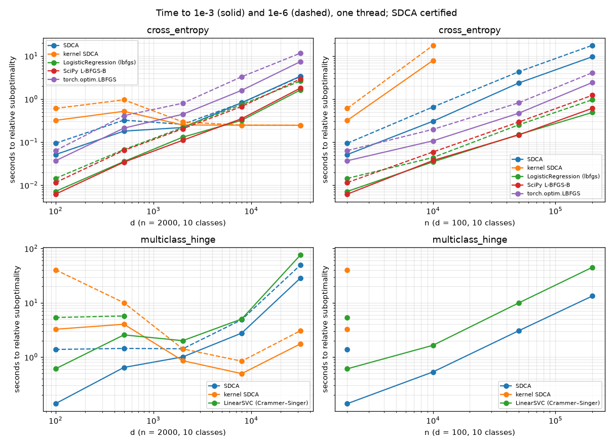

# Performance

Runtime and memory of libsdca 0.3.0 compared with PyTorch, JAX and scikit-learn.
Ratios are libsdca's time (or memory) divided by the reference's: below 1 means
libsdca is faster or uses less. The tables and the protocol are in the
[technical report](https://mlapin.github.io/libsdca/).

## Test systems

| | GPU | CPU (Linux) | CPU (macOS) |
| --- | --- | --- | --- |
| Hardware | NVIDIA A100-SXM4-80GB | AMD EPYC 7J13, 32 cores | Apple M5 Pro |
| Software | PyTorch 2.15.0+cu132, Triton 3.9.0, Liger 0.8.5, JAX 0.12.0.1 | PyTorch 2.15.0 (2.14.1 for the [solver](#solver) shape sweep), JAX 0.12.0.1, scikit-learn 1.9.1 | PyTorch 2.15.0, JAX 0.12.0.1 |
| Threads | — | 32 and 1 | 18 and 1 |

CUDA times are CUDA-event timings with warm-up; compilation is excluded. CPU times are
wall time per call, Python and autograd included, median of 7 to 15 interleaved rounds.
Inputs are `3·N(0, 1)` logits with `reduction="mean"`. Distillation teachers are the
student plus `0.5·N(0, 1)` at `T = 2`, and masked CE marks about 1% of the classes
positive. "Compiled" is `torch.compile(dynamic=False)` of the same objective written in
PyTorch.

The tables were measured during the 0.3.0 release work. Later changes fix edge cases and
are not expected to move these numbers beyond run-to-run variance.

## PyTorch on CUDA

Forward and backward on the A100, in milliseconds:

| Loss, shape | dtype | libsdca | Eager | Compiled | Liger |
| --- | --- | ---: | ---: | ---: | ---: |
| CE, 8192 × 128256 | bfloat16 | 3.842 | 11.052 | 4.134 | 3.773 |
| CE, 8192 × 128256 | float32 | 7.329 | 22.268 | 7.581 | 7.656 |
| CE, 8192 × 32000 | bfloat16 | 0.999 | 2.438 | 1.030 | 1.121 |
| CE, 8192 × 32000 | float32 | 1.853 | 5.477 | 1.895 | 1.764 |
| Top-5 CE, 1024 × 128256 | bfloat16 | 1.110 | 10.165 | 4.255 | — |
| Top-5 CE, 1024 × 128256 | float32 | 1.407 | 10.813 | 6.035 | — |
| Masked CE, 4096 × 32000 | bfloat16 | 0.926 | 3.705 | 0.875 | — |
| Masked CE, 4096 × 32000 | float32 | 1.214 | 6.087 | 1.357 | — |
| Distillation, 4096 × 32000 | bfloat16 | 2.276 | 3.633 | 2.821 | — |
| Distillation, 4096 × 32000 | float32 | 2.920 | 7.259 | 4.680 | — |

The references compute the same objective: top-5 CE as a PyTorch composition, masked CE
as cross-entropy with uniform targets on the positives, and distillation as
`F.cross_entropy(student / T, softmax(teacher / T))`.

- libsdca is faster than compiled PyTorch on every row except bfloat16 masked CE (1.06×).
- Liger is 1.8% faster at bfloat16 8192 × 128256 and 5.0% faster at float32 8192 × 32000.
  Liger writes the gradient into the logits during the forward pass, which rounds it
  before the upstream scale is applied; libsdca rounds every gradient entry once.

### Tall logits

Many rows with few classes. Short rows are packed several per thread block. Forward and
backward, bfloat16, milliseconds, with the ratio to compiled PyTorch in bfloat16 and
float32:

| Loss, shape | libsdca | Compiled | Eager | / compiled, bf16 (fp32) |
| --- | ---: | ---: | ---: | ---: |
| CE, 262144 × 10 | 0.212 | 0.408 | 0.417 | 0.52 (0.56) |
| CE, 65536 × 100 | 0.182 | 0.295 | 0.231 | 0.61 (0.60) |
| CE, 16384 × 1000 | 0.206 | 0.438 | 0.239 | 0.47 (0.62) |
| Top-5 CE, 262144 × 10 | 0.624 | 1.201 | 23.687 | 0.52 (0.48) |
| Top-5 CE, 65536 × 100 | 0.487 | 1.036 | 7.179 | 0.47 (0.45) |
| Top-5 CE, 16384 × 1000 | 0.398 | 0.938 | 3.366 | 0.42 (0.31) |
| Masked CE, 262144 × 10 | 0.234 | 0.277 | 0.279 | 0.84 (0.79) |
| Masked CE, 65536 × 100 | 0.226 | 0.289 | 0.286 | 0.78 (0.80) |
| Masked CE, 16384 × 1000 | 0.244 | 0.304 | 0.525 | 0.80 (1.02) |
| Distillation, 262144 × 10 | 0.202 | 0.280 | 0.307 | 0.72 (0.73) |
| Distillation, 65536 × 100 | 0.207 | 0.294 | 0.309 | 0.70 (0.65) |
| Distillation, 16384 × 1000 | 0.354 | 0.301 | 0.501 | 1.18 (1.21) |

libsdca is faster than eager PyTorch in all 24 training cells and faster than compiled
PyTorch in 21. Forward-only masked CE takes 1.36–2.85× compiled PyTorch's time because it
also records the statistics the backward needs.

### Memory

- The fused CUDA kernels keep 4 to 13 float64 values per row between forward and backward
  (cross-entropy 6, distillation 13), not an `(N, C)` tensor.
- When nothing else holds the logits, the backward of cross-entropy, the `k = 1` hinges and
  the multilabel losses writes the gradient over them. In an eager training step of a
  language-model head (8192 rows, 4096 features, 128256 classes, bfloat16 autocast, fused
  AdamW), peak memory above the step's start is 1066 MiB, against 8080 MiB for eager
  PyTorch. Inside `torch.compile` the gradient is not written in place, and the peak is
  2068 MiB.
- Distillation peaks at 250 MiB in bfloat16 at 4096 × 32000 (compiled PyTorch: 750 MiB),
  top-5 CE at 250–502 MiB (compiled: about 1505 MiB).
- `linear_cross_entropy` never stores the `(N, V)` logits. On CUDA it takes 1.02–1.06×
  compiled PyTorch's time in bfloat16 and 1.00–1.03× in float32, with 20–24% less memory
  in float32. Its float32 weight-gradient accumulator uses 1.4–1.6× compiled PyTorch's
  memory in bfloat16 at 4096 and 8192 rows.

## PyTorch on the CPU

libsdca's time divided by PyTorch's, forward and backward, at 4096 × 1000 and
4096 × 32000 in all four dtypes, with the CPU extension:

| Loss | Linux / eager | Linux / compiled | macOS / eager | macOS / compiled |
| --- | --- | --- | --- | --- |
| `cross_entropy` | 0.13–0.61 | 0.28–0.87 | 0.53–0.82 | 0.41–0.84 |
| `multiclass_hinge`, top-5 `topk_hinge_alpha` | 0.02–0.18 | 0.04–0.20 | 0.05–0.33 | 0.14–0.42 |
| `multilabel_cross_entropy`, `distillation_loss` | 0.08–1.15 | 0.32–0.93 | 0.35–1.09 | 0.40–0.91 |

- The kernels sweep each row in cache-sized tiles in one pass and save a few doubles per
  row, where PyTorch keeps one or more `(N, C)` intermediates.
- PyTorch has no hinge kernel. libsdca scans each row in registers and writes only the
  nonzero gradient entries.
- Peak memory of a forward and backward call is the size of the gradient.

`linear_cross_entropy` with 32 threads (float32) takes 0.86–0.97× eager PyTorch's time and
0.93–1.07× compiled PyTorch's. From 4096 rows it uses 0.34–0.56× eager's memory and
0.68–0.79× compiled's.

## JAX

On the CPU, `cross_entropy` under `jit` takes 0.32–1.29× the time of the same loss written in
`jax.numpy` (Linux, 32 threads) and 0.67–0.96× optax's, from 4096 × 1000 to 1024 × 128256.

On the A100 at 4096 × 32000, forward and backward in milliseconds:

| Loss | dtype | libsdca | `jax.numpy` |
| --- | --- | ---: | ---: |
| Masked CE | float32 | 1.894 | 1.771 |
| Masked CE | bfloat16 | 1.395 | 1.289 |
| Masked CE | float64 | 3.902 | 4.595 |
| Distillation | float32 | 4.311 | 2.945 |
| Distillation | bfloat16 | 3.590 | 1.772 |
| Distillation | float64 | 11.325 | 6.085 |

Distillation on the JAX GPU backend needs more passes over the logits than the plain
`jax.numpy` expression to keep its accuracy guarantees.

## Solver

`fit` against scikit-learn on the same objective and to the same suboptimality (EPYC 7J13,
1e-2 to 1e-5, one and 32 threads):

- `multiclass_hinge`: 0.14–0.59× the time of `LinearSVC` (Crammer–Singer). Both use dual
  coordinate ascent with shrinking.
- `cross_entropy`: 1.3–14× the time of `LogisticRegression` (lbfgs). SDCA solves each
  example's step exactly and works one example at a time; lbfgs needs few iterations on
  these well-conditioned problems and uses matrix-matrix products.

Which solver is faster depends on the shape of the data. On synthetic problems with
10 classes, `n` examples and `d` features (one thread):

- `multiclass_hinge`: primal SDCA is fastest on tall data (`d < n`), and kernel SDCA from
  `d = n` on, including the time to compute the Gram matrix.
- `cross_entropy`: lbfgs is fastest on tall and square data. On wide data, kernel SDCA is
  faster than lbfgs only if the Gram matrix `K = X Xᵀ` is not counted: at `d = 16n` it is
  then 6.7–12× faster. With the time to compute `K` included, it takes 1.3–3.0× lbfgs's
  time at `d = 4n` and 1.1–1.9× at `d = 16n`. Excluding `K` is fair only when it is
  computed once and reused, for example across a sweep over `C`.

The SDCA times are cold `fit` calls with `tol` set to the target, including the duality-gap
certificate. The lbfgs times are those of the first iterate below the target; its
evaluation is not counted.

Memory follows the same split. L-BFGS keeps about `(2p + 2)·d·m` doubles of history
(`p = 10`), primal SDCA the `n·m` dual variables, and kernel SDCA the `n × n` Gram matrix.

Against v0.2.0, entropy coordinate steps are 1.9–7.2× faster and `cross_entropy` trains
1.7–2.7× faster in float64. `precision="float32"` makes `cross_entropy` training another
1.6–1.9× faster, with float-arithmetic errors ([numerics](numerics.md#what-each-precision-guarantees)).

## How the losses run

`backend="auto"` picks the path per call; `libsdca.torch.explain_backend` reports it.

- **CUDA:** fused Triton kernels with float64 row statistics, deterministic row
  reductions and no host synchronization. A small C++ extension, built on first use,
  launches them from C++ autograd; without it, Triton launches the same kernels.
- **CPU:** an ATen/OpenMP extension built on first use for the instruction set of
  PyTorch's own kernels, or else the prebuilt native library. 16- and 32-bit logits use
  float32 exponentials in SIMD registers with float64 row statistics.
- **Any device:** a tensor implementation of the same losses (`backend="torch"`).
- **JAX:** `jax.numpy` implementations, and on the CPU an XLA FFI call into the native
  library, with no host round trip.

See [TORCH.md](../python/TORCH.md#devices-and-backends) and
[JAX.md](../python/JAX.md#backends) for the full routing.

## Where libsdca is slower

- **Tall logits on the CPU.** At 10 classes, float32 CE takes 1.30× (one thread) to 2.78×
  (32 threads) the fastest PyTorch reference's time, `multilabel_cross_entropy` 4.03–5.43×,
  16-bit distillation 1.4–1.9× up to 100 classes, and JAX float32 CE 1.28–1.78×. The CPU
  kernels process one row at a time.
- **Distillation.** On CUDA at 16384 × 1000: 1.18–1.21× compiled PyTorch. On the CPU in
  16-bit at 4096 × 1000: 1.14–1.15× eager with 32 threads and 1.51× on one thread. On the
  JAX GPU backend: 1.46–2.03× `jax.numpy`.
- **Masked CE on CUDA** at 4096 × 32000 in bfloat16: 1.06× compiled PyTorch; at
  16384 × 1000 in float32: 1.02×.
- **Small calls.** On CUDA, calls up to about 10⁶ logits are bound by host overhead
  (1.2–1.3× PyTorch's wall time, measured on an H100). On the CPU, forward-only calls of
  256 × 10 logits take a few microseconds more than PyTorch's.
- **`fit` for `cross_entropy`** against lbfgs, see [Solver](#solver).
- **16-bit `linear_cross_entropy` on the CPU** uses about 1.7× eager PyTorch's memory at
  1024 × 4096 × 128256: the weight gradient is summed in float32 before rounding.
- **Proximal losses** solve a root per row. They have no PyTorch counterpart; against
  PyTorch compositions solved to the same accuracy, libsdca takes 0.10–0.90× compiled
  PyTorch's time.
