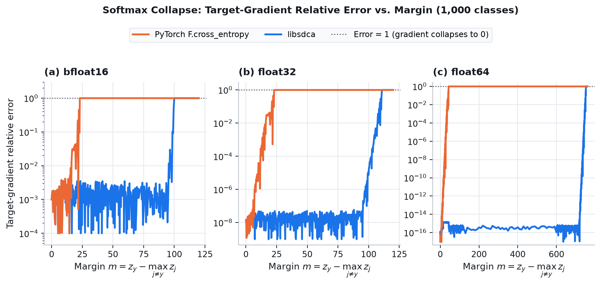
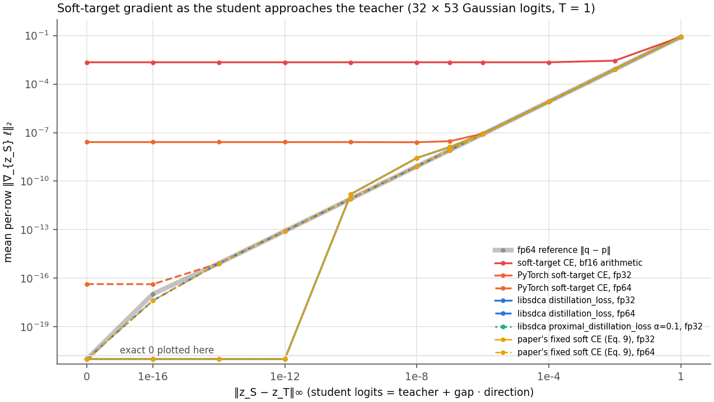

# Softmax collapse and cancellation

Barron, Gnanapragasam and Tschannen,
[*A Fix for Softmax and Cross-Entropy*](https://arxiv.org/abs/2610.31642) (2026), identify
two floating-point failure modes in standard softmax cross-entropy. This page explains both,
shows how `libsdca` avoids them across all losses, and summarizes our reproduction of the
paper's experiments.

## Softmax collapse

For logits $z$ and target $y$, let $\tau = \sum_{j \neq y} \exp(z_j - z_y)$. Cross-entropy is
$\log(1 + \tau)$ and its target gradient is $p_y - 1 = -\tau / (1 + \tau)$. When $\tau$ falls
below $\frac{1}{2}\mathrm{ulp}(1)$ ($2^{-24} \approx 6\times 10^{-8}$ in `float32`,
$2^{-53} \approx 1.1\times 10^{-16}$ in `float64`), $1 + \tau$ rounds to $1$: both the loss
and target gradient collapse to exact zero while competitor gradients remain nonzero, breaking
the zero-sum gradient invariant. For two classes this occurs at margin $16.6$ (`float32`) or
$36.7$ (`float64`); with $C - 1$ equal competitors it shifts by $\log(C - 1)$.

`libsdca` evaluates the loss as $\mathrm{log1p}(\tau)$ and forms the target gradient
from the competitor sum (Eqs. 5–6 of the paper), remaining nonzero down to the output
dtype's subnormal limit (`104` in `float32`, `745` in `float64` for two classes):

```python
import torch
import libsdca

logits = torch.tensor([[0.0, -20.0]], requires_grad=True)
target = torch.tensor([0])
torch.nn.functional.cross_entropy(logits, target)    # tensor(0.)
loss = libsdca.cross_entropy(logits, target)         # tensor(2.0612e-09)
loss.backward()
logits.grad                                          # [[-2.0612e-09, 2.0612e-09]]
```



*Target-gradient relative error vs. prediction margin (1,000 classes, H100, 100-digit
reference). At error = 1, the gradient has collapsed to exact zero.*

The same formulation is used across every `libsdca` loss (top-$k$ cross-entropy, proximal
cross-entropy, multilabel cross-entropy, and the hinges) on CPU and CUDA in `float16`,
`bfloat16`, `float32` and `float64`.

## Softmax cancellation

The knowledge-distillation gradient is $\mathrm{softmax}(z_{\mathrm{S}} / T) - \mathrm{softmax}(z_{\mathrm{T}} / T)$.
As student logits $z_{\mathrm{S}}$ approach teacher logits $z_{\mathrm{T}}$, subtracting the
two rounded probability vectors loses significant digits: even at $z_{\mathrm{S}} = z_{\mathrm{T}}$,
PyTorch returns up to $4.6\times 10^{-9}$ in `float32` ($2.2\times 10^{-3}$ in `bfloat16`)
instead of zero.

`libsdca.distillation_loss` evaluates each entry from the centered log-ratio $z_{\mathrm{S}} - z_{\mathrm{T}}$
using $\mathrm{expm1}$ (Eq. 9 of the paper), producing an **exact zero gradient** at
equal logits in every dtype:

```python
student = torch.randn(32, 10, requires_grad=True)
libsdca.distillation_loss(student, student.detach(), temperature=2.0).backward()
torch.count_nonzero(student.grad)                    # tensor(0)
```



*Distillation gradient norm as student logits approach teacher logits ($T = 1$, modular
addition $a + b \bmod 53$ batch of $32 \times 53$ logits).*

## Relation to the paper

`libsdca` implements the paper's $\mathrm{log1p}$ and centered-$\mathrm{expm1}$
formulations inside its own fused CUDA, C++ ATen, JAX and C ABI kernels, independently of
external framework patches ([numerics.md](numerics.md)).

## Reproduction

We reproduced Sections 3, 6 and 7 of Barron et al. on an H100 (and verified on an A100):
- **Grokking on $a + b \bmod 31$ (Table 1, Fig. 5):** A 1-layer ReLU transformer trained for
  10,000 full-batch epochs with AdamW ($\epsilon \in \{10^{-8}, 10^{-12}, 10^{-16}\}$) on a
  50/50 split of the $31^2 = 961$ pairs (**$480$ training examples** and $481$ test examples),
  across 5 random seeds (`0–4`, plus a second set `5–9`). At each epoch, a training example
  (one row of the $480 \times 31$ training logit matrix) is counted as *collapsed* if its
  target-class gradient has rounded to exact `0` while competitor gradients remain nonzero.
- **Additional grokking tasks (Fig. 6) and teacher-initialized distillation on $a + b \bmod 53$ (Fig. 7).**

Test accuracy (%) on $a + b \bmod 31$ at Adam $\epsilon = 10^{-8} / 10^{-12} / 10^{-16}$,
and final logit margin at $\epsilon = 10^{-16}$:

| dtype | Loss | Paper (5 JAX seeds) | Reproduction (seeds 0–4) | Reproduction (seeds 5–9) | Margin ($\epsilon=10^{-16}$) |
| --- | --- | --- | --- | --- | ---: |
| `float32` | Fixed CE (paper) | 100.0 / 99.6 / 99.0 | 98.3 / 97.8 / 97.2 | 100.0 / 99.9 / 100.0 | 36.8 |
| `float32` | Standard CE (`F.cross_entropy`) | 94.3 / 96.4 / 96.5 | 92.5 / 93.4 / 92.8 | — | 12.9 |
| `float32` | `libsdca.CrossEntropyLoss` | — | 98.3 / 97.3 / 97.3 | — | 36.8 |
| `bfloat16` | `libsdca.CrossEntropyLoss` | — | 99.2 / 98.3 / 98.2 | — | 36.9 |
| `float32` | `libsdca.TopKHingeLoss(k=3, gamma=1, variant="alpha")` | — | **100.0 / 100.0 / 100.0** | **100.0 / 100.0 / 100.0** | 1.0 |

Key takeaways:

- **Standard `float32` CE loses target gradients on `73–88%` of the 480 training examples
  (`350–422` examples per batch):** Once margins approach the `16.6` `float32` cliff,
  `F.cross_entropy` zeroes out the target gradient on most training examples while still
  pushing competitor logits down. The batch gradient no longer sums to zero, causing
  margins to stall at `12.9` and test accuracy to drop by `5–6` points (`92.5–93.4%`).
- **`libsdca.CrossEntropyLoss` matches the paper's Fixed CE (`0 / 480` collapsed examples,
  identical equilibrium margins `17.9 / 27.4 / 36.8`):** On identical seeds, `libsdca` and
  the paper's Fixed CE formula produce the same accuracy (`98.3 / 97.3 / 97.3%` vs.
  `98.3 / 97.8 / 97.2%`). The `1–2` point gap between seeds `0–4` and the paper's
  `99.0–100.0%` (which used JAX PRNG seeds) comes from a single hard 50/50 data split
  (seed `2`, which ends at `89.4–94.6%` while seeds `0` and `4` reach `100.0%`, and where
  `bfloat16` quantization happens to land ~1 point higher); on seeds `5–9`, exact-gradient
  CE reaches **`99.9–100.0%`**, matching the paper.
- **Smooth top-$k$ hinge (`TopKHingeLoss`) avoids $\epsilon$-driven margin growth and solves
  every seed to `100.0%`:** Because cross-entropy gradients never vanish completely, AdamW
  keeps inflating logits until $e^{-m} \approx \epsilon$ (`17.9` $\to$ `36.8`). Smooth
  top-$k$ hinge ($\gamma = 1$) instead has an exact zero gradient once the margin reaches
  `1.0`, solving all 10 seeds (including seed `2`) to `100.0%` test accuracy across all $\epsilon$.
- **Exact cancellation prevents student drift in distillation:** When a student MLP is
  initialized at a `100%`-accurate teacher on $a + b \bmod 53$, standard `bfloat16`
  soft-target CE has a nonzero cancellation floor at $z_{\mathrm{S}} = z_{\mathrm{T}}$ that
  drives the student down to `17%` test accuracy ($\mathrm{KL} \to 1.74$). `DistillationLoss`
  and `ProximalDistillationLoss` have an exact zero gradient at equal logits and keep the
  student at `100%` accuracy ($\mathrm{KL} = 0$) across all 2,000 steps.

Full tables, training curves and the StableMax analysis are on the
[project page](https://mlapin.github.io/libsdca/).
